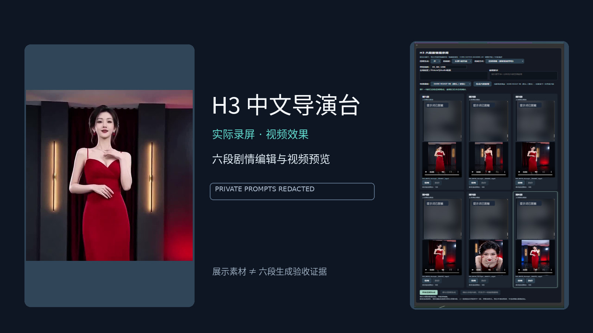

# H3 8207 实验导演台｜MiniMax-H3 六段连续视频生成

**H3-8207 Experimental** · ComfyUI 中文实验导演台 · `v0.1.0-preview` 预发布版

[English README](README_EN.md) · **[下载 v0.1.0-preview](https://github.com/asd454314633-byte/H3-8207-Experimental/releases/tag/v0.1.0-preview)** · [查看工作流](workflows/current)

把一段故事拆成六段中文提示词，分别编辑、提交生成，并通过真实的上一段 Latent 续接视频。本项目提供中文操作界面、连续任务调度、PreBake 缓存和结果合并，是独立于 8197 正式生产线的**实验源码预览版**。

## 真实界面与视频展示

### 动态视频预览

**[▶ 打开完整 MP4 演示](https://github.com/asd454314633-byte/H3-8207-Experimental/blob/main/assets/showcase/h3-six-segment-demo-github.mp4)**

此链接打开真实 MP4 的仓库文件页，可通过 Download raw file 下载；README 不承诺内嵌视频播放器。

### 六段中文编辑框

点击截图可打开原始尺寸。剧情内容已脱敏，界面来自真实录屏。

> **素材来源与证据边界：**这四份素材复用自 8197 历史真实录屏及脱敏展示，用于展示真实界面及视频效果，**不代表 8207 当前公开候选已完成同版本 GPU E2E**。完整录屏中涉及的其它功能或字幕不能自动当作本项目的验收成果。没有生成或伪造新的操作画面。

## 六段中文导演台能做什么

| 能力 | 使用方式与边界 |
|---|---|
| 全中文操作与六段剧情管理 | 六段提示词分别编写、编辑和管理；手工创作不需要 AI 导演模型。 |
| 单段与连续生成调度 | 可选段落独立开始，或使用合法前序进行连续生成；运行期间可编辑后续草稿并继续点击执行进入队列。 |
| 上一段 Latent 续接 | 使用真实前段视频 Latent 的 Native masked continuation，保留前序身份、模型与回执检查；没有合法前序时可选择独立开始。 |
| Conditioning PreBake | 复用有效 conditioning，按提交段落及实际依赖处理缺失或过期缓存；缓存命中不替代真实数据校验。 |
| 连续状态与执行回执 | Story、执行快照、任务身份及成功结果分别记录，用于恢复、重试和前序资格判断。 |
| 六段自动合并 | 对选中的合法视频结果进行合并，避免混入其它故事或旧尝试；**混尺寸自动合并仍为 HOLD**。 |

以上描述源码和工作流提供的能力；历史成功与当前公开候选的验收状态分别列在下方，不将离线检查当作当前 GPU 成功。

## 8207 相比 8197 的实验特性

8207 是独立实验线，复用公开 8197 基线并叠加实验节点与工作流，不是对正式生产版的自动升级。

- **Story / Execution 解耦：**故事身份可保持稳定；每次提交使用独立执行快照，后续草稿修改不混写已提交任务。
- **运行中编辑与排队：**继续编辑尚未提交的剧情，同时保留点击执行进入队列的路径；队列等待与实际执行的 300 秒预算分开计算。
- **按段落恢复 PreBake：**针对实际提交内容和依赖规划缓存，保留已成功的历史版本及真实前序校验。
- **明确记录的空间重采样续接：**跨分辨率时，将真实前段视频 Latent 尾部映射到本段采样网格；音频前缀保持原值，同尺寸路径保持逐值一致。审计记录变换，不冒充重采样前后的原始张量完全相同。
- **实验工作流与扩展：**提供 H3 实验编排，以及独立的 Qwen Image 2.1 图像工作流；依赖、模型和证据边界各自独立。

详见 [当前预发布说明](docs/PREVIEW_RELEASE_NOTES.md)；旧差异报告保留历史范围，不代表每项实验均已完成动态验收。

## 六段工作流操作

1. 在独立 ComfyUI 环境安装所需节点和模型，加载 [当前工作流目录](workflows/current) 中适合任务的 JSON；配置自己的参考素材和模型路径。
2. 在六段中文编辑框填写剧情，设置参考槽、生成参数和起始段。可以手工输入，也可以使用可选 AI 导演辅助起草。
3. 选择独立生成或真实续接，点击对应段的执行入口。已有任务运行时仍可排队提交；每次已提交任务保留固定快照，新编辑用于下一次提交。
4. 需要续接时，使用匹配的成功前序 Latent 与回执；失败后从合法位置恢复，单独重做时保留历史成功版本。合并前核对当前选择的结果版本和视频尺寸。

不要把任意历史视频或 Latent 当作合法前序。跨尺寸 Native 续接和混尺寸成片合并是两个不同问题，后者仍需要共同输出画布。

## AI 导演、Qwen 与六段框的关系

| 层次 | 作用 | 与六段视频的关系 |
|---|---|---|
| **H3 六段导演台** | 核心视频控制系统，管理六段文本、生成、续接和结果。 | 可直接手工编写提示词，不依赖 AI 导演才能编辑。 |
| **可选 AI 导演** | 辅助生成或优化剧情提示词。 | 可接入不同的兼容语言模型服务，不限定某一个模型。 |
| **MiniMax-H3 内部 Qwen3-VL 编码器** | H3 视频模型内部所需组件。 | 属于 H3 模型栈，与可选 AI 导演和 Qwen Image 不是同一概念。 |
| **Qwen Image 2.1** | 独立文生图、单图编辑、多图编辑与背景移除实验工作流。 | **不是 H3 六段连续视频生成的前置条件**，其验收门禁不阻断六段框。 |

## 安装、下载与源码重建

- **[版本下载与 SHA256 校验附件](https://github.com/asd454314633-byte/H3-8207-Experimental/releases/tag/v0.1.0-preview)**：源码 ZIP、完整文件清单和 `SHA256SUMS.txt`。已有标签和附件保持不变；main 上的首页改进不改变该冻结源码包。
- **[当前工作流 JSON](workflows/current)**：选择并打开对应文件，通过 GitHub 的 Raw / Download 下载。模板已经脱敏，需替换占位素材和路径。
- **[源码重建与配置说明](REPRODUCIBILITY_REPORT.md)**：[固定版本锁](config/baseline.lock.json)、[重建脚本](scripts/rebuild/rebuild_from_8197.py)、[依赖安装脚本](scripts/setup/install_deps.py) 和 [模型路径示例](config/examples/extra_model_paths.example.yaml)。请使用独立空目录，不覆盖生产环境。
- **[依赖来源清单](config/third_party_nodes.json)** 与 [锁定版本](config/third_party_nodes.lock.json)：模型权重、第三方节点的运行依赖和可选服务须另行准备；源码获取或重建成功不等于运行环境安装验收。

本仓库不附带模型权重、私人参考素材、运行缓存或成套可直接使用的个人环境。历史重建材料中较早的阻塞说明应结合 [R2 修正记录](docs/BLOCKER_RESOLUTION.md)、[当前发布门禁](PUBLIC_RELEASE_GATE.md) 和 [预发布说明](docs/PREVIEW_RELEASE_NOTES.md) 阅读。

## 按版本区分的验收状态与限制

| 对象 | 已有证据与结论 |
|---|---|
| **8197 V29 正式生产版** | 历史 Agent 自动化六段生成及自动合并有真实 **PASS** 记录；不转移为本候选的验收。 |
| **8207 历史实验环境** | 已有用户确认的人工成功验收及部分自动化 GPU 证据，保留原始版本与范围。 |
| **当前 8207 脱敏公开候选** | `EXPERIMENTAL_PUBLICATION_READY = PASS`；`GPU E2E = NOT_TESTED`；`PRODUCTION_PROMOTION = HOLD`。 |
| **Qwen Image 2.1** | 历史四项 GPU **PASS** 保留；当前候选动态验证为 `NOT_RETESTED`，独立于 H3 六段验收。 |

`NOT_TESTED` 仅指当前公开候选没有重新完成**同版本完整 GPU E2E**，不代表六段功能从未成功生成。已记录的 48 项 CPU/JavaScript 回归、静态完整性和固定源码重建通过，不证明当前候选的真实浏览器、排队或视频端到端通过。本次首页完善没有新增 GPU 验收。

**已知限制：**混尺寸自动合并仍为 **HOLD**，需要明确的共同输出画布；当前公开候选完整六段 GPU E2E 未测试，Qwen 当前动态验证未重测，完整运行环境等价性仍为 HOLD。来源、模型和可选服务缺失时，相应功能需先按说明配置。

证据入口：[发布门禁](PUBLIC_RELEASE_GATE.md) · [预发布说明](docs/PREVIEW_RELEASE_NOTES.md) · [已记录的预发布离线检查](manifests/preview_validation.json)。

## 许可证、来源与隐私

项目独立代码按 [MIT 许可证](LICENSE) 声明。第三方组件各自保留原许可与署名，不能将整个模型、宿主或上游节点统称为本项目原创或 MIT：ComfyUI 宿主补丁遵循 GPL-3.0，工作流模板派生内容及 vendored 节点保留相应来源与许可证。没有暗示 MiniMax 或 ComfyUI 官方认证。

请阅读 [第三方声明](THIRD_PARTY_NOTICES.md)、[逐项许可报告](THIRD_PARTY_LICENSE_REPORT.md)、[GPL 补丁许可](overlays/LICENSE-GPL-3.0.txt) 和 [工作流模板许可](licenses/workflow_templates-MIT.txt)。模型本身的使用须遵守其各自许可。

公开内容已排除私人路径、剧情原文、输入参考、账本、缓存、日志、密钥和模型权重；四份历史展示素材已脱敏且保留原始字节。详见 [脱敏说明](PRIVACY_SANITIZATION_REPORT.md) 与 [安全及隐私说明](docs/SECURITY_AND_PRIVACY.md)。

## English documentation

[Read the complete English README →](README_EN.md)
