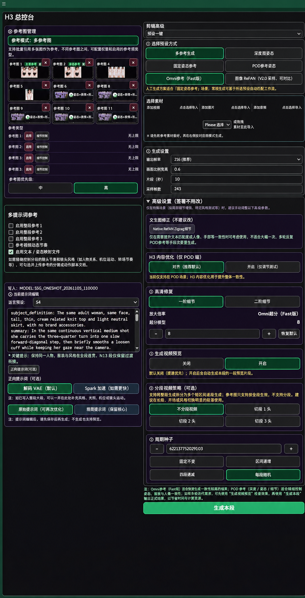
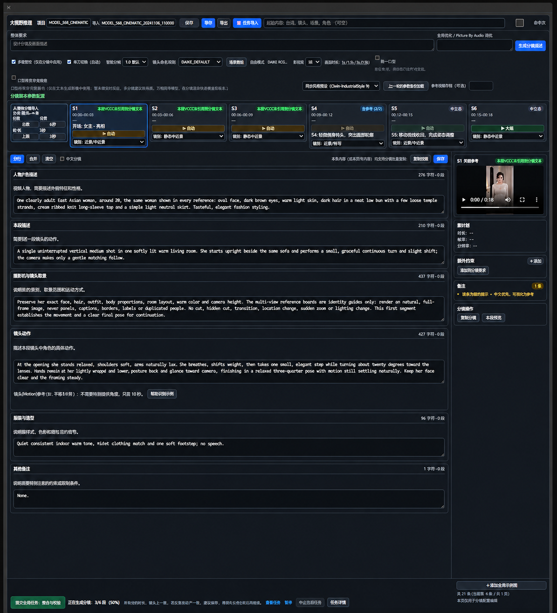

# H3 界面展示图（2026-11-05）

本目录保存两张由用户提供的 H3 工作界面截图，经 AI 高清增强及重绘后生成的展示图片。

> **注意：AI 生成增强图可能改写文字、数字、控件状态或细节。仅供项目界面展示，不属于真实、逐像素的原始截图；不可作为功能、参数、性能或 GPU 验收依据。**

| 图片 | 描述 | 尺寸 | SHA256 |
|---|---|---|---|
| [H3 总控台](h3-console-ai-enhanced.png) | 双栏式参考图及视频生成控制界面 | 897×1752 | `0e7dcf39b7cbd00b0293728daecd355efddc7cd83ae8d7a1238560ef2d035c7a` |
| [六段分镜编辑界面](six-segment-editor-ai-enhanced.png) | 六段故事/分镜与文本编辑页面 | 1195×1316 | `24aad28d67a30c1606c31ab16243ed0569a5daa0738cac2bcca854a6a964616b` |

图像仅用于界面演示，不表示已验证对应工作流或插件可在第三方平台运行。原始图及个人素材未一并上传。
